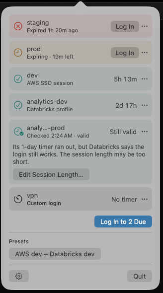

# PrinceClockIn

[](https://github.com/princelundgren/prince-clockin/actions/workflows/ci.yml)
[](LICENSE)

A macOS menu bar app that shows how long each command-line cloud login has left, notifies you before
one expires, and logs in to the ones you pick, one after another, when you click.

<picture>
  <source media="(prefers-color-scheme: dark)" srcset="docs/images/panel-dark.png">
  
</picture>

## What it does

- **Tracks your logins**: AWS IAM Identity Center sessions (`aws sso login`), Databricks CLI
  profiles (`databricks auth login`), gcloud user accounts (`gcloud auth login`), Azure CLI
  tenants (`az login --tenant`), and any other login as a custom login.
- **Shows at a glance** in the menu bar whether a login is about to expire or has expired, with a
  symbol and no countdown; the symbol pulses while logging in. The panel has a tile per login,
  in the order you drag them into in Settings → Logins, with its time left.
- **Notifies once** before a login expires, 30 minutes ahead by default, which you change in
  Settings → Notifications. Logins that need it at the same time, or while the Mac slept, share
  one notification, whose Log In button starts them. With a notification schedule on in
  Settings → Notifications, one due outside it is held until its next From time.
- **Logs in when you click**: any tile that isn't running, queued, failed, awaiting approval or
  asking, Log In to N Due when several are due, or a preset you make in Settings → Presets, such
  as "AWS dev + Databricks dev". Logins run one at a time, since several browser sign-ins at once
  conflict, and a card shows which one runs, the progress ("1 of 2") and Cancel All. It never logs
  in on its own.
- **Notices logins you do in a terminal**: an `aws sso login` shows up as soon as the AWS CLI
  writes its cache file, and when the file can't tell a login from a renewal, the tile asks "Its
  login changed at <time>. Was that you?". A `gcloud auth login` is read from gcloud's credential
  store, and an `az login` or `az logout` from the Azure CLI's `azureProfile.json`. A Databricks
  profile, gcloud account or Azure tenant is checked with its CLI when it enters its notification
  time, or when you click Check Now in Settings → Logins.
- **Takes a timer by hand**: when a tile asks "Was that you?", Set Timer… takes when the login
  expires or when you logged in.
- **Runs a custom login's command in Terminal**, so you can type passwords or MFA codes there, or
  waits while you log in your own way. Its timer starts when you click Done, within the login
  timeout (5 minutes by default, set in Settings → Logins).
- **Works from the keyboard**: Return triggers the panel's one highlighted button, and Escape
  cancels an open Set Timer, else closes the panel. With Keyboard Navigation on, the arrow keys
  move between tiles.

## Install

1. Download `PrinceClockIn-<version>.dmg` from the
   [latest release](https://github.com/princelundgren/prince-clockin/releases/latest).
2. Open it and drag PrinceClockIn to Applications. The app is signed with Developer ID and
   notarized by Apple.
3. Open PrinceClockIn. It lives in the menu bar, with no Dock icon, and asks once for permission
   to send notifications. The first custom login that runs a command also asks for permission to
   control Terminal.
4. Click the menu bar icon, then **Add Logins…**. Settings opens on Logins with its + menu: the AWS
   SSO sessions, Databricks profiles, gcloud accounts and Azure CLI tenants found in your config
   files, and Custom Login…. After you add a found one, it offers to set its timer if you're already
   logged in. To keep the timers running after you log out or restart, turn on **Launch at login**
   in Settings → General; it is off by default.

After that, PrinceClockIn updates itself with [Sparkle](https://sparkle-project.org). It checks
once a day; when an update is waiting, a dot appears beside the menu bar icon, the panel says
"Update <version> available" with **View…**, and the right-click menu offers **Install Update
<version>…**. An update installed while logins run relaunches the app once they finish.

## Requirements

- macOS 26 or later.
- The CLIs for what you track, on your login shell's `PATH`:
  - `aws` (AWS CLI v2), with sessions in the `[sso-session <name>]` form of `~/.aws/config`;
  - `databricks`, with profiles that use `auth_type = databricks-cli`;
  - `gcloud`, with user accounts logged in through `gcloud auth login`;
  - `az` (Azure CLI), with users logged in through `az login`.
- zsh or bash as your login shell, which PrinceClockIn reads the `PATH` from.

## Known limits

- **The session length decides the timer.** AWS sessions default to 8 hours, the IAM Identity
  Center default. A Databricks login has no default, since its limit is a token policy on your
  account: until you set its session length, its timer is unknown, so it never notifies and is
  checked only when you click Check Now. A gcloud account or Azure tenant has no default either;
  until you set one, it shows Logged in after a login, never notifies and is checked only when you
  click Check Now. An Azure tenant's real limit is set by its Conditional Access policies.
- **gcloud service accounts and application-default credentials** aren't offered; track them as
  custom logins.
- **A gcloud account outside the default universe** (`email#universe` in gcloud's store) is logged
  in and checked in the universe gcloud is set to (`core/universe_domain`), not its own.
- **Azure CLI service principals, managed identities and Cloud Shell** aren't offered; track them
  as custom logins.
- **An Azure login can't pin the user**: `az login --tenant` signs in to the tenant, and you
  choose the account in the browser. Choose another account and the app still counts it as a
  login of the tracked one.
- **An Azure tenant can read as logged out without `az logout`**: when another user's login takes
  over a shared subscription's entry, or `az account list --refresh` drops the tenant's entry.
- **An Azure login is checked only while its user is the Azure CLI's active account** (the
  default subscription, `az account set`), since the CLI checks as that account; otherwise the
  check is skipped and the last one stays.
- **An Azure check can read valid after the session ends**: the Azure CLI can't be made to refresh,
  so a session revoked or lapsed while it holds an unexpired access token (60 to 90 minutes by
  Microsoft's default) can read valid until that token expires.
- **A gcloud login through the app leaves gcloud's active account as it was**: it signs the
  account in without making it active, so switch with `gcloud config set account` if you want it.
- **An `az login` done in a terminal while the tenant is still listed isn't seen**, since
  `azureProfile.json` changes the same way for `az account set`; set its timer by hand. A login
  counts only when the tenant appears after being absent.
- **Another user's `az login` to a subscription you share** replaces your entry for it, since the
  Azure CLI keeps one entry per subscription, and can read as a logout of yours.
- **A Databricks profile with another auth type** (personal access token, `azure-cli`,
  machine-to-machine) isn't offered; track it as a custom login. A profile with no `auth_type`
  shows up after `databricks auth login --profile <name>`, which switches it to OAuth and removes
  any token or secret it holds.
- **Databricks account profiles** can be tracked but are never checked: they run on their timer
  alone.
- **`AWS_CONFIG_FILE`, `DATABRICKS_CONFIG_FILE`, `CLOUDSDK_CONFIG` or `AZURE_CONFIG_DIR` set only
  in a shell rc file** isn't seen: the app reads only `PATH` from your shell.
- **With fish or another login shell**, the app uses a standard `PATH` (Homebrew, `/usr/local` and
  the system directories) and may not find the CLIs.
- **⌘-dragging the icon out of the menu bar quits the app**, which stops its timers and notifications.
  Open it from Applications to bring the icon back.

## Privacy

- No telemetry, analytics or crash reporting, and no third-party SDK that collects any of them.
- The only network traffic the app itself makes is Sparkle's update check, with Sparkle's system
  profiling off. The CLIs it runs make their own traffic.
- It never stores, logs, shows or sends a token, a client secret or a value from your shell
  environment. To tell a new AWS login from a renewal, it reads the cache file's refresh token
  only to fingerprint it, and keeps that fingerprint in memory only. From gcloud's credential
  store it reads only the account names and their row numbers, never the credentials. From the
  Azure CLI it reads only `azureProfile.json`, which lists users, tenants and subscriptions and
  holds no credential, never its token cache.
- Your logins, presets, timers and settings are stored as readable JSON in
  `~/Library/Application Support/PrinceClockIn/`. A custom login's command is stored there as
  plain text, so it must not contain a secret. Which commands you've approved to run is kept as
  hashes in the app's preferences on this Mac, so a command that arrives in a copied file doesn't
  run until you click Run It on its tile.
- A login's output is kept in memory only, to show you why it failed.
- Bug reports come from you, through GitHub issues; nothing is collected.

## Support

Report a bug or ask a question in
[GitHub issues](https://github.com/princelundgren/prince-clockin/issues), or with **Report an
Issue…** in the right-click menu or Settings → About.

## Building from source

You need macOS 26 and Xcode 27.2, the version CI builds with. From the repository root:

```sh
swift test --package-path PrinceClockInCore    # the core's tests
scripts/install-xcodegen.sh                    # the pinned XcodeGen, into build/tools
cd PrinceClockIn
../build/tools/xcodegen/bin/xcodegen generate
xcodebuild -scheme PrinceClockIn -configuration Debug \
  -derivedDataPath ../build/DerivedData CODE_SIGNING_ALLOWED=NO build
```

The Xcode project is generated from `PrinceClockIn/project.yml` and isn't committed. Every decision
the app makes lives in the `PrinceClockInCore` package and its tests; `PrinceClockIn/` holds the
AppKit and SwiftUI app. The design is in
[`docs/superpowers/specs/2026-11-17-princeclockin-design.md`](docs/superpowers/specs/2026-11-17-princeclockin-design.md),
and [`AGENTS.md`](AGENTS.md) has the rules a change follows. Changes land through pull requests.

## Third-party notices

PrinceClockIn includes [Sparkle](https://github.com/sparkle-project/Sparkle). Its license, with
the notices of the code Sparkle bundles, ships inside the app and is in
[`PrinceClockIn/PrinceClockIn/ThirdPartyNotices.txt`](PrinceClockIn/PrinceClockIn/ThirdPartyNotices.txt).

## License

[MIT](LICENSE)
